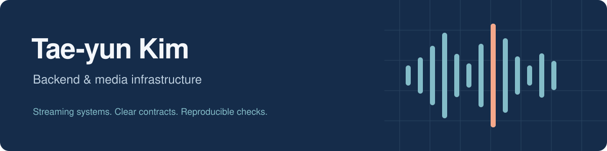

  <a href="https://www.linkedin.com/in/tae-yun-kim-851a02304/">LinkedIn</a>
  &nbsp; / &nbsp;
  <a href="https://github.com/3K-PokeClip/PokeClip-mono">PokeClip</a>
  &nbsp; / &nbsp;
  <a href="https://github.com/bluenviron/mediamtx/pulls?q=is%3Apr+author%3Axodbs1021+is%3Amerged">Open-source contributions</a>

### Hello, I'm Tae-yun.

I work on **backend systems and media infrastructure**, with a focus on authentication, streaming workflows, and failure recovery.

I'm the team lead for **PokeClip**, a three-person project in the AI·SW Maestro program. I make design decisions for the media and infrastructure components, coordinate service contracts, and define how we verify the results. I also contribute fixes to **MediaMTX**, the open-source media server we use.

### Selected work

| Project | What I work on |
| :--- | :--- |
| **[PokeClip](https://github.com/3K-PokeClip/PokeClip-mono)** | A live-stream highlight and clip service. Media ingestion, recording and playback workflows, AWS infrastructure, and access control. **Team project · integration in progress.** |
| **[Spring Boot Board](https://github.com/xodbs1021/kty-board-project)** | A personal Java backend project with session authentication, posts and comments, JPA, and EC2/RDS deployment. Explored request routing and view-count behavior. |
| **[KTY Codex Harness](https://github.com/xodbs1021/kty-codex-harness-template)** | A Codex-focused development harness with project profiles, review rules, verification scripts, and completion checks. |

### Open source · MediaMTX

**5 authored PRs merged** as of October 29, 2026. Selected contributions:

| Pull request | Change |
| :--- | :--- |
| [#6427](https://github.com/bluenviron/mediamtx/pull/6427) | Fixed a shutdown hang after certificate persistence fails. |
| [#6205](https://github.com/bluenviron/mediamtx/pull/6205) | Fixed comparison and sharing of default authentication configuration. |
| [#6154](https://github.com/bluenviron/mediamtx/pull/6154) | Validated HLS segment counts against the selected HLS variant. |

More merged contributions

- [#6155](https://github.com/bluenviron/mediamtx/pull/6155) — Corrected external command exit-code reporting on non-Windows platforms.
- [#6182](https://github.com/bluenviron/mediamtx/pull/6182) — Continued an existing contributor's patch for disabling offline-source recording, and addressed source/configuration reapplication.

### Tools & interests

**Languages** &nbsp; Go · Java · Bash  
**Backend & data** &nbsp; Spring Boot · PostgreSQL · MySQL  
**Infrastructure** &nbsp; AWS · Docker · Linux · GitHub Actions  
**Media** &nbsp; MediaMTX · SRT · LL-HLS · fMP4

I'm particularly interested in turning operational requirements into **shared code, explicit contracts, and reproducible checks**.

How I work

I use AI tools for research, implementation, test execution, and review. My role is to select and confirm requirements, design alternatives, and verification criteria, and to coordinate contracts across services. In PokeClip, the core Spring services, render worker, web client, and OBS integration are primarily implemented by teammates.

